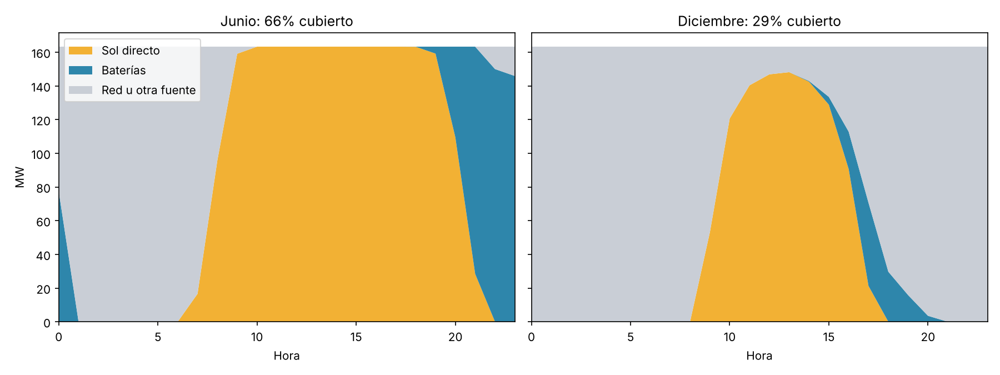

# TFG Solaria: cobertura solar y con baterías de un centro de datos

Código y datos del **Anexo 1 (Figura 4)** del TFG sobre Solaria. El cálculo estima qué parte del consumo de un centro de datos pueden cubrir el sol y las baterías del segundo contrato de Solaria con Merlin.

## Cómo ejecutarlo

```bash
pip install matplotlib   # solo para la figura
python simulacion_cobertura.py
```

## Resultados (2025)

| | Solo sol | Sol + baterías |
|---|---|---|
| Cobertura anual | 40 % | 50 % |
| Junio | 52 % | 66 % |
| Diciembre | 25 % | 29 % |
| Horas con al menos el 80 % cubierto | 34 % | 45 % |



## Método

**Producción solar.** La planta del contrato tiene 426 MW de potencia máxima, a la que solo llega con sol pleno. Según Solaria, una planta así produce al año lo mismo que 1.915 horas a esa potencia, unos 816 GWh. Esa producción no es uniforme: nada de noche, poco por la mañana, máximo a mediodía, más en verano que en invierno y menos los días nublados. Por eso repartimos los 816 GWh entre las horas del año según la producción solar real de toda España en cada hora de 2025 (REE-ESIOS). Si en una hora España produjo el 0,05 % de su energía solar del año, nuestra planta produce en esa hora el 0,05 % de sus 816 GWh. La serie de REE incluye la termosolar, que también produce de noche, así que ponemos a cero las horas sin sol (el 2,2 % de la energía) antes de repartir.

**Consumo del centro.** Suponemos que el centro de datos llena su conexión de 213 MW. Por cada MW de servidores hacen falta 1,5 MW de conexión (apartado 4.1), así que caben 142 MW de servidores. A eso se suma un 15 % para refrigeración y otros equipos, el máximo que permite el proyecto de real decreto, lo que da 163 MW. El centro consume esos 163 MW todas las horas del año, que es el caso más exigente.

**Qué pasa en cada hora.** Cada hora se compara la producción solar con el consumo:
- Si el sol produce más de 163 MW, el centro toma lo que necesita y el sobrante carga las baterías (600 MWh, a un máximo de 150 MW). Si están llenas, ese sobrante se pierde.
- Si el sol produce menos, las baterías cubren lo que falta, también a un máximo de 150 MW, hasta vaciarse. El resto sale de la red.
- Las baterías solo se cargan con sol, nunca de la red, y de cada 100 MWh que guardan devuelven 90.

## Supuestos

| | Supuesto | Valor | Origen |
|---|---|---|---|
| 1 | Potencia solar | 426 MW | Contrato Merlin 2 |
| 2 | Capacidad de las baterías | 600 MWh | Contrato Merlin 2 |
| 3 | Conexión del centro | 213 MW | Contrato Merlin 2 |
| 4 | Potencia de las baterías | 150 MW (4 horas) | Supuesto; el contrato no la indica |
| 5 | Año representativo | 2025 | Último año completo |
| 6 | Perfil horario | Solar de toda España | REE-ESIOS |
| 7 | Horas sin sol | Se ponen a cero (2,2 %) | Quitar termosolar nocturna |
| 8 | Producción anual | 1.915 h equivalentes (816 GWh) | Solaria (CMD 2025) |
| 9 | Conexión por MW de servidores | 1,5 MW | Apartado 4.1 |
| 10 | Extra para refrigeración y otros | 15 % | Proyecto de real decreto |
| 11 | Consumo | 163 MW constantes | Centro a plena carga |
| 12 | Rendimiento de las baterías | 90 % ida y vuelta | Supuesto habitual |
| 13 | Carga de las baterías | Solo con sol sobrante | Supuesto |
| 14 | Estado inicial de las baterías | Vacías | Supuesto |
| 15 | Degradación de paneles y baterías | No se considera | Simplificación |
| 16 | Límites de red entre planta y centro | No se consideran | Simplificación |
| 17 | Sol sobrante sin hueco en baterías | Se pierde | Supuesto |

## Archivos

- `simulacion_cobertura.py`: simulación completa. Los supuestos están al principio del archivo.
- `datos/datos_horarios_2022_2026.csv`: precio horario del mercado diario (OMIE, €/MWh) y generación solar peninsular horaria (REE-ESIOS, MWh, fotovoltaica + termosolar), de enero de 2022 a septiembre de 2026. Desde el 1/10/2025 el precio es la media de los cuatro cuartos de hora.
- `resultados/cobertura_horaria_2025.csv`: resultado de cada hora (sol directo, baterías, red y sol perdido).
- `resultados/figura4_junio_diciembre.png`: media de cada hora en junio y en diciembre.

## Fuentes

- OMIE: precios del mercado diario.
- REE-ESIOS (2026): generación solar horaria.
- Solaria (2026): hecho relevante a la CNMV sobre el segundo acuerdo con Merlin (213 MW de acceso, PPA de 426 MWp y PPA de baterías de 600 MWh).
- Solaria, Capital Markets Day 2025: 1.915 horas equivalentes.
